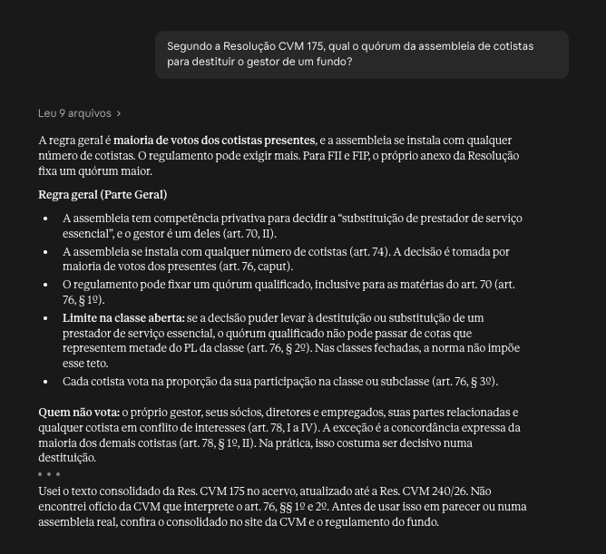

# Normas do mercado de capitais

**O texto das normas do mercado de capitais brasileiro e cerca de 15 mil julgados da CVM e do CRSFN, organizados para o Claude consultar artigo por artigo e citar a data-base de cada texto.**

São as Resoluções e Instruções CVM vigentes, Pareceres de Orientação e Ofícios-Circulares, leis e decretos, normas do CMN e do BCB, códigos da ANBIMA e regulamentos da B3. A atualização é quinzenal, a partir das fontes oficiais. Feito por um analista de crédito estruturado para o próprio trabalho: FIDC, CRI, fundos e ofertas.

Instalação no claude.ai ou no Claude Code em 5 minutos: veja [Instalação](#instalação).

## Por que não basta perguntar ao Claude

Sem o acervo, o Claude responde de memória ou busca na web. A memória tem data de corte e mistura redação vigente com redação revogada, e ele cita número de artigo com a mesma segurança quando acerta e quando erra. A busca na web acha sites de terceiros e notícias, mas não diz até qual ato alterador o texto está atualizado, e um ofício ou um julgado específico raramente aparece. Com o acervo, ele abre a norma, lê o artigo, cita o texto que leu e informa a data-base.

Medimos a diferença com 30 perguntas de normas e 30 de julgados, todas com gabarito conferido na fonte oficial. O mesmo modelo respondeu com e sem o acervo, sem busca na web, e outro modelo corrigiu as respostas sem saber de que modo vinha cada uma (detalhes em [Bateria de perguntas](#bateria-de-perguntas)):

| Em 30 perguntas | Com o acervo | Sem o acervo |
|---|---|---|
| Normas: conteúdo certo | 27 | 5 |
| Normas: cita o dispositivo certo | 26 | 4 |
| Normas: informa a data-base do texto | 29 | 0 |
| Julgados: acha o caso certo | 25 | 1 |
| Julgados: resposta inteiramente certa | 24 | 1 |

## O que muda na resposta

A skill orienta o Claude a consultar o acervo antes de responder, nesta ordem:

1. **Acha a norma pelo índice:** por número, por assunto ou pelo mapa do produto (FIDC, CRI, FII).
2. **Lê o artigo**, e não a norma inteira. Cada artigo tem título próprio, e o Claude vai direto a ele.
3. **Cita o dispositivo** (artigo, parágrafo, inciso) e a **data-base**: até qual ato a norma foi atualizada e quando o texto foi conferido.
4. **Avisa o que pode estar desatualizado:** ato publicado cuja consolidação oficial ainda não saiu, divergência entre o consolidado da CVM e os atos, texto lido por OCR.
5. **Termina com o link da fonte oficial**, para conferência antes de usar em parecer ou contrato.

Uma resposta real no claude.ai, com o plugin `normas` (trechos do início e do fim, em 2026-11-09):



Nos julgados, o caminho é parecido. O Claude acha o caso pelo número do processo, pelo tema ou pela norma citada, lê a ficha e traz data, relator, resultado e valor. Para o fundamento do voto, lê o texto integral (ver [Ficha e texto integral](#ficha-e-texto-integral)). Avisa também quando a ementa foi escrita por modelo de linguagem e não pela CVM.

## Por que Markdown

- **Cabe na leitura do modelo.** O PDF de uma resolução tem dezenas de páginas, com cabeçalho, rodapé e quebra de coluna. Aqui, cada norma é um arquivo de texto e cada artigo é um título. O modelo lê só o trecho que importa, sem ruído de layout.
- **Diz até quando vale.** O cabeçalho de cada arquivo informa a situação (vigente ou revogada), a data-base, o nível de verificação e as incertezas conhecidas. O Claude repassa essa informação na resposta.
- **Guarda o histórico.** Nas normas centrais de fundos e securitização, cada ato alterador é um commit com a data do DOU. Dá para ver a redação de um artigo em qualquer data.
- **Não prende a uma ferramenta.** É texto aberto no GitHub. Pessoas leem direto, e outras ferramentas de IA ou de busca usam os mesmos arquivos.

## O que é

Acervo em Markdown de normas do mercado de capitais brasileiro (regulação e orientação da CVM, leis e decretos, normas do CMN e do BCB e autorregulação da ANBIMA e da B3), organizado para consulta por pessoas e por assistentes de IA: um arquivo por norma, um título por artigo, metadados de situação e de data-base no cabeçalho e o histórico de alterações preservado em commits, um por ato alterador. O objetivo é dar ao analista de crédito estruturado o texto consolidado e rastreável até a fonte, com a data até a qual cada norma foi atualizada.

## Aviso

Este material não é oficial e não substitui o Diário Oficial da União nem os sites dos órgãos e entidades de origem (CVM, BCB, ANBIMA, B3). O texto pode conter erros de conversão ou estar desatualizado em relação a atos publicados depois da data-base de cada norma. Confira sempre a fonte oficial antes de usar em parecer, contrato ou decisão.

## Status

Público desde 2026-11-05. Acervo atual, em camadas declaradas (data-base 2026-10-28 nas camadas 1 a 3, 2026-10-29 na camada 5 e 2026-10-30 na camada 4):

1. **Regulação da CVM:** as 155 Resoluções CVM vigentes (as 154 do Estoque Regulatório da CVM de 2026-09-08, mais a Res. 249) e as 5 Instruções CVM ainda em vigor (438, 445, 489, 516 e 579, contábeis de fundos). Ficam fora as revogadas, as que só alteram outras e a Res. 26 (prorrogação de prazos de 2021, sem efeito atual [verificar]).
2. **Interpretação da CVM:** os 41 Pareceres de Orientação e os 179 Ofícios-Circulares editados desde 2022-01-01 (7 deles por OCR, porque o PDF da CVM não tem camada de texto). Os 421 anteriores a 2022 aparecem só como verbete no índice, com link. A CVM não publica a vigência de pareceres e ofícios.
3. **Leis e decretos:** 28 leis e 1 decreto no texto compilado do Planalto lido em 2026-10-28, sem histórico (Leis 6.385, 6.404, 4.728, 4.595, 14.430, 11.101, 13.506 e outras; ver `plugins/normas/skills/consultar-normas/normas/indices/leis.md`).

4. **CMN e BCB:** 128 normas vigentes que tocam mercado de capitais, fundos, securitização, crédito negociável e instituições do mercado (57 do CMN e 71 do BCB: Resoluções, Resoluções Conjuntas, Circulares, Cartas Circulares e Instruções Normativas), no texto compilado pelo BCB, sem histórico nem conferência contra o DOU: o da busca de normas, ou, nas 26 normas alteradas cujo texto na busca é a redação original, o PDF da última versão compilada (relido em 2026-10-30). Os atos que só alteram essas normas aparecem como verbete. Ficam fora política monetária, câmbio comercial, crédito rural, pagamentos de varejo, cooperativas e consórcios, prudencial e PLD; o critério de cada norma está em `fontes/perimetro-camada4.json`.
5. **Autorregulação:** 39 documentos vigentes da ANBIMA (códigos, regras e procedimentos, glossário, deliberações, pareceres e perguntas e respostas) e 59 da B3 (regulamentos, manuais de normas, manuais de procedimentos operacionais e glossários), extraídos dos PDFs. Texto de titularidade da ANBIMA e da B3, reproduzido para uso informativo e retirado a pedido; ver `plugins/normas/skills/consultar-normas/normas/autorregulacao/README.md`.

6. **Julgados:** 14.990 julgados na v1.1 (14.991 na data-base 2026-11-04, ver `CHANGELOG.md`), com fichas dentro do plugin `normas` e texto integral em `julgados/`, na raiz do repositório: 1.419 PAS julgados pela CVM, 10.501 decisões do Colegiado (2002 em diante), 1.714 termos de compromisso, 1.332 acórdãos do CRSFN em recurso de decisão da CVM e 24 arquivos anuais de decisões antigas (1978–2001). Cada julgado traz o texto da fonte, processo, data, relator, resultado, ementa (a da CVM ou do CRSFN, ou extraída por LLM e marcada `ementa_fonte: extracao`), tema e as normas citadas, com índices por ano, por tema e por norma, e o índice reverso de citações nas normas. Dados pessoais (CPF, RG, endereço, qualificação, testemunhas) saem do texto; o nome da parte fica. Julgado não é norma: diz o que a CVM ou o CRSFN decidiu num caso, com a redação das normas da época.

   **PAS de 2022 em diante.** A listagem de PAS julgados da CVM para em 2025-05 e não traz parte dos julgados de 2022 a 2025. Esse período entra também pelas notícias de resultado e pelos extratos de sessão do SEI (`scripts/julgados_noticias.py`): a base tem 264 PAS julgados de 2022 a 2025 e 25 de 2026 (data-base 2026-11-05). A ausência de um julgado na base não prova que ele não exista.

Cada norma informa o nível de verificação (`nivel_verificacao`): 38 normas têm histórico por ato desde a publicação original, um commit por ato com a data do DOU: 37 Resoluções CVM (o núcleo de fundos e securitização, 17, 21, 30, 50, 60, 80, 160 e 175, e as substantivas 6, 8, 9, 11, 13, 19, 20, 31, 32, 35, 43, 44, 45, 46, 47, 53, 54, 67, 77, 81, 86, 88, 135, 161, 166, 193, 210, 215 e 232) e a Instr. CVM 489; as demais têm o texto vigente convertido por script do consolidado ou do ato publicado pela CVM, ou do compilado do Planalto.

Conferência: `fontes/RESULTADOS.md` (testes por norma) e `fontes/DIVERGENCIAS.md` (onde o histórico e o consolidado da CVM diferem, e por quê).

As datas-base acima são as da construção do acervo. Daqui em diante elas avançam com a atualização quinzenal (seção seguinte).

## Atualização

A cada duas semanas, às quartas-feiras, um processo compara as fontes oficiais (CVM, BCB, Planalto, ANBIMA, B3 e CRSFN) com o acervo e aplica o que mudou. Ele usa os mesmos scripts da construção, com testes e um revisor por IA. A primeira execução agendada é a de 2026-11-18.

Se uma execução não acontece no dia (máquina desligada, feriado), ela roda na primeira oportunidade. Nada se perde, porque a comparação é com o acervo, e não com a execução anterior.

- **Entra sem revisão humana** só o que tem conferência independente: texto convertido por script de fonte oficial, com cobertura de pelo menos 99% e testes verdes.
- **Passa por revisão humana:** texto lido por OCR, revogação, vigência diferida, norma ou documento novo fora do perímetro, ato que altera uma norma com histórico por ato e qualquer item que o revisor por IA marque.
- **Hoje, tudo está em período de observação:** o processo propõe e uma pessoa aprova cada mudança.
- **Ato publicado, consolidado ainda não:** entre a publicação de um ato que altera uma norma e a chegada do texto consolidado oficial, a norma traz um aviso no campo `incerteza` e aparece na lista "Atos publicados ainda não aplicados" do índice (`plugins/normas/skills/consultar-normas/normas/indice.md`). Nesse intervalo, leia o ato alterador junto com a norma.
- **Versões:** a versão do plugin `normas` sobe quando o conteúdo dele muda. O claude.ai só baixa o conteúdo novo quando a versão sobe.
- **Até quando vale:** cada índice traz a linha "Fontes conferidas até AAAA-MM-DD". Espere uma defasagem de até cerca de duas semanas entre a publicação na fonte e a entrada no acervo.

As taxas de erro da seção Verificação medem a construção, não cada atualização. O que se confere em cada atualização está em `VERIFICACAO.md`, seção "Atualização automática".

## Verificação

Auditoria cega por amostragem da construção, em 2026-10-30, nas 5 camadas: 297 itens sorteados (263 na amostra e 34 na re-auditoria) (semente registrada), refeitos ou transcritos por um modelo que só via a fonte, e comparados com o acervo por script. Resultado por camada, método, erros achados e ressalvas em `VERIFICACAO.md`. Em resumo:

- Camada 1: zero erro de texto em 114 itens (taxa abaixo de 2,6% com 95% de confiança).
- Camada 2: zero erro em 22 itens fora do OCR (abaixo de 13,6%). Os 7 ofícios lidos por OCR têm erros pontuais de leitura: confira o PDF da CVM.
- Camada 3: zero erro em 28 itens (abaixo de 10,7%).
- Camada 4: 1 erro, corrigido. Depois da correção, zero erro em 50 itens (abaixo de 6%).
- Camada 5: 1 erro, sem correção. Ressalva: no Glossário ANBIMA, verbetes e definições podem estar desalinhados.

### Julgados

Auditoria cega por amostragem de 2026-11-03 a 2026-11-04, em seis rodadas (1.021 itens), com adjudicação de cada diferença contra a página da fonte. Na última rodada:

- Texto em PDF: zero erro em 20 decisões do Colegiado, 12 termos e 10 acórdãos do CRSFN; 2 erros em 20 PAS (linha fora de lugar).
- Texto por OCR (813 julgados, `nivel_verificacao: ocr`): 4 erros em 24 (tabela ou figura que é imagem, dígito de tabela, nome de testemunha num carimbo, este já corrigido). Ressalva: confira número de tabela na fonte.
- Dados pessoais: nenhum dado que ficou em 40 qualificações.
- Extração por LLM: ementa 2 erros em 40; resultado 2 em 80, corrigidos; tema zero em 80.

Método, todas as rodadas e ressalvas em `VERIFICACAO.md`, seção Julgados.

## Bateria de perguntas

30 perguntas com gabarito, cobrindo as 5 camadas, mais 2 fora do perímetro (`testes/bateria-v1.md`). Cada gabarito foi conferido na fonte oficial. As perguntas foram respondidas pelo Claude Sonnet 5.5, sem web, em dois modos:

- **com o acervo:** só lendo os arquivos do plugin (na v1.0, `normas`);
- **sem o acervo:** sem nenhuma ferramenta.

Um Claude Opus 5.5 corrigiu as 60 respostas sem saber de que modo vinha cada uma. Em 2026-10-30:

| Camada | Perguntas | Conteúdo certo, com acervo | Conteúdo certo, sem acervo |
|---|---|---|---|
| 1. CVM | 9 | 9 | 1 |
| 2. Pareceres e ofícios | 5 | 3 | 2 |
| 3. Leis | 5 | 5 | 1 |
| 4. CMN e BCB | 5 | 5 | 0 |
| 5. ANBIMA e B3 | 4 | 3 | 0 |
| Fora do perímetro | 2 | 2 | 1 |
| **Total** | **30** | **27** | **5** |

Com o acervo, 26 respostas citaram o dispositivo certo e 29 informaram a data-base; sem ele, 4 e 0. As 3 respostas erradas com o acervo têm a mesma causa: ofício ou documento da ANBIMA sem artigos que o modelo não abriu, porque procurou na norma de base. É o ponto fraco da consulta.

### Julgados

30 perguntas sobre julgados (`testes/bateria-v2.md`), com gabarito conferido na página da CVM ou do CRSFN, respondidas com e sem os plugins de julgados (v1.1, com o texto integral dentro do plugin; a bateria não foi refeita para o fluxo de fichas da 2.0.0) e corrigidas às cegas pelo Claude Opus:

| Critério | Com os julgados | Sem os julgados |
|---|---|---|
| Acha o caso certo | 25 | 1 |
| Conteúdo certo | 27 | 2 |
| Ressalvas de fonte | 29 | 5 |
| Tudo certo | 24 | 1 |

As 6 falhas com os julgados são de busca: o caso está no acervo, mas a resposta não o achou.

## Mapas por produto

`plugins/normas/skills/consultar-normas/normas/mapas/` tem um mapa para CRI, um para FIDC e um para FII: que normas do acervo regem cada produto, por camada, com os dispositivos-chave e o caminho do arquivo. São mapas de navegação, não parecer.

## Instalação

Um único plugin, `normas`, traz as normas e os julgados.

**No claude.ai** (navegador ou aplicativo). Antes, em Configurações → Recursos, ligue "Executar código na nuvem": as skills precisam dele.

1. Em Personalizar → Plugins, clique em Adicionar → Adicionar marketplace → Adicionar de um repositório. Informe `dmarcheti/normas-mercado-capitais` e clique em Sincronizar. A sincronização leva 1 a 2 minutos.
2. Busque o plugin `normas` e clique em Adicionar.
3. Ligue a skill `consultar-normas` (Personalizar → Skills, ou dentro do plugin). Instalar o plugin não liga a skill: sem este passo, o Claude responde pela busca na web e ignora o acervo.

Numa conversa nova, pergunte normalmente. Por exemplo: "Segundo a Resolução CVM 175, qual o quórum para destituir o gestor de um fundo?"

Conta de empresa (Team ou Enterprise): o administrador pode ter bloqueado marketplaces externos.

**No Claude Code:**

```
/plugin marketplace add dmarcheti/normas-mercado-capitais
/plugin install normas@normas-mercado-capitais
```

Para quem for usar com outro assistente de IA, ver `COMECE-AQUI.md`.

### Quem tinha os plugins `julgados-*`

Na 2.0.0, os cinco plugins de julgados (`julgados-pas`, `julgados-tc-crsfn`, `julgados-colegiado-2002-2008`, `julgados-colegiado-2009-2015` e `julgados-colegiado-2016-2026`) saíram do marketplace. Remova-os; o plugin `normas` já cobre os julgados.

- **claude.ai:** em Personalizar → Plugins, remova cada um. Atualize o marketplace `normas-mercado-capitais` e confira se `normas` está na versão 2.0.0.
- **Claude Code:** `/plugin uninstall julgados-pas@normas-mercado-capitais`, e o mesmo para os outros quatro. Depois atualize o marketplace e o plugin `normas`.

## Estrutura do repositório

```
.claude-plugin/marketplace.json
plugins/normas/
  .claude-plugin/plugin.json
  skills/consultar-normas/
    SKILL.md
    normas/                    as normas na íntegra: indice.md, indices/, mapas/,
                               cvm/, cmn/, bcb/, leis/, autorregulacao/
    julgados/
      indice.md                perímetro, contagens e lista dos subíndices
      indices/                 por norma citada, tema, processo, tipo e ano
      fichas/<grupo>/          uma ficha por julgado, em arquivos de até 24 KB
julgados/                      texto integral dos julgados, fora do plugin
scripts/  tests/  testes/  fontes/  docs/
```

O acervo vai dentro da pasta da skill porque algumas plataformas, como o claude.ai, só montam essa pasta: o que fica ao lado dela não chega ao Claude. Os textos integrais dos julgados ficam fora do plugin, na raiz do repositório, e o Claude os lê pelo GitHub quando precisa.

## Ficha e texto integral

Cada julgado tem uma **ficha** no plugin (`fichas/<grupo>/AAAA[-NN].md`, seção `## <id>`) com id, tipo, processo, data, relator, resultado, ementa, tema, dispositivos citados, um trecho da decisão (até 1.500 caracteres) e o link do **texto integral** no GitHub (`julgados/`, na raiz). O Claude acha o caso pelos índices, responde pela ficha e só busca o texto integral quando a pergunta pede o que a ficha não traz: o fundamento do voto, os fatos, a dosimetria.

- **Claude Code:** o Claude abre o link com o WebFetch, depois do pedido de permissão do próprio Claude Code.
- **claude.ai:** a busca de página só abre link que você colou na conversa ou que veio de uma busca. O Claude não consegue abrir o link lido na ficha. Ele responde pelo que a ficha permite afirmar e pede: "Para eu ler o texto integral, cole este link na conversa". Cole o link e ele completa a resposta.

Os links dependem do caminho `julgados/` na branch `main`: ele é estável e está declarado no `SPEC.md`.

## Licenças, dados pessoais e retirada

**Atos oficiais.** Os textos de leis, decretos, resoluções, pareceres, ofícios e decisões da CVM, do CRSFN, do CMN e do BCB não são objeto de direito autoral (Lei 9.610/98, art. 8º, IV: "os textos de tratados ou convenções, leis, decretos, regulamentos, decisões judiciais e demais atos oficiais"). O que este repositório acrescenta a eles tem licença própria.

**O trabalho do repositório: CC BY 4.0** (`LICENSE`). Seleção, estrutura, frontmatter, índices, mapas, histórico por ato, notas e divergências. Pode copiar e adaptar, com atribuição.

**Código: MIT** (`LICENSE-codigo`). Os scripts em `scripts/`.

**Autorregulação (camada 5).** A pasta `plugins/normas/skills/consultar-normas/normas/autorregulacao/` não está sob nenhuma licença deste repositório: reproduz texto de titularidade da ANBIMA e da B3, para uso informativo e não comercial, e sai a pedido delas. O pedido segue o formulário abaixo; mais detalhes no README da pasta.

**Julgados.** São atos oficiais da CVM e do CRSFN, com o texto da fonte. O dado pessoal (CPF, RG, endereço, e-mail, telefone, data de nascimento, dados bancários, qualificação pessoal e nome de testemunha) é cortado e marcado `[dado pessoal retirado]`, pela política do `SPEC.md` (seção Julgados, subseção Corpo). Nome de parte, relator e demais agentes do processo ficam, nos termos do `SPEC.md`. O titular que queira a retirada de dado seu pede pelo formulário.

**Retirada.** O pedido é só pelo [formulário `retirada`](https://github.com/dmarcheti/normas-mercado-capitais/issues/new?template=retirada.yml) das issues do repositório. O projeto não tem e-mail de contato.
- **Não escreva o dado pessoal na issue**, que é pública. Informe o id ou o caminho do documento e o tipo de dado (por exemplo, "CPF" ou "endereço").
- O mantenedor atende o pedido e apaga a issue depois.
- A retirada vale da versão corrente em diante. Versões anteriores do histórico do Git e cópias de terceiros podem conter o texto.

**Aviso.** Este material não é aconselhamento jurídico. A fonte oficial prevalece, e cada norma traz o link para ela no frontmatter (`fonte_original` e `fonte_consolidada`). Veja também a seção Aviso, no início.
